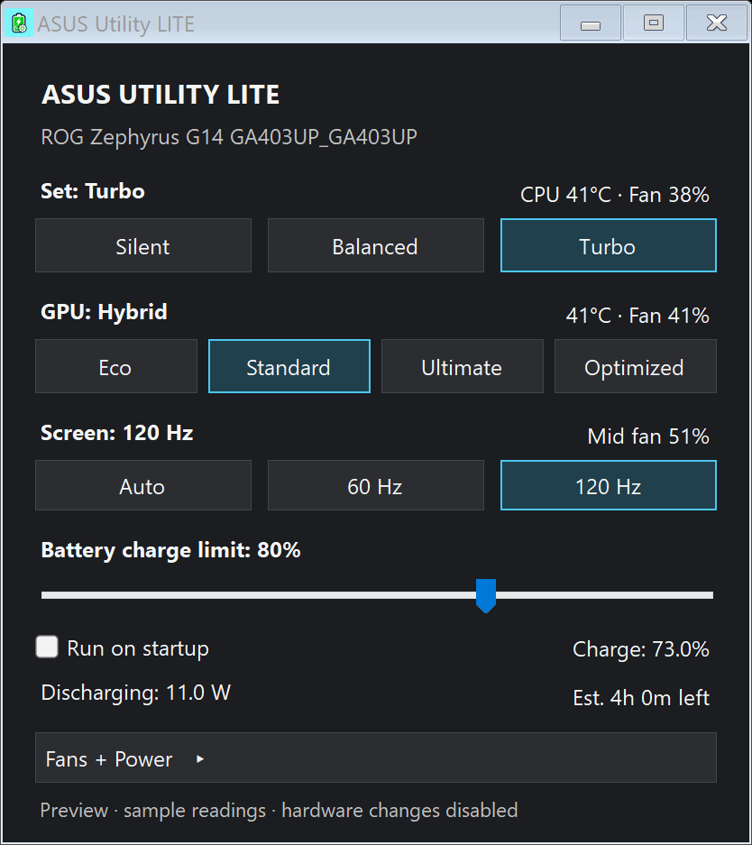

# ASUS Utility LITE

A compact Windows utility for ASUS ROG laptop performance, graphics, cooling, display refresh rate, and battery controls. Built around the ROG Zephyrus G14 GA403UP; available controls depend on the laptop's firmware.

## Download

- **[Download the Windows app](https://github.com/TimCodingThings/ASUS-Utility-App-LITE/releases/latest/download/ASUS-Utility-LITE.exe)**
- [Download the complete package](https://github.com/TimCodingThings/ASUS-Utility-App-LITE/releases/latest/download/ASUS-Utility-LITE.zip) — executable, source, instructions, and license.
- [All releases](https://github.com/TimCodingThings/ASUS-Utility-App-LITE/releases)
- [Repository copy of the executable](https://github.com/TimCodingThings/ASUS-Utility-App-LITE/raw/refs/heads/main/ASUS%20Utility%20LITE.exe) — fallback download.

Windows 10/11 x64 with .NET Framework 4.8 and the ASUS System Control Interface driver. No installation or bundled runtime is needed. Administrator access is required for hardware controls.



## Use

1. Save the app in a permanent folder. Exit G-Helper or other laptop-control software first.
2. Launch the executable and accept Windows' administrator prompt.
3. Choose a performance mode. Closing the window leaves the app in the system tray; use **Exit** there to stop it.

**Performance:** Silent, Balanced, and Turbo use ASUS firmware profiles.

**GPU:** Eco disables the dedicated GPU; Standard enables hybrid graphics. Ultimate changes the MUX routing and asks before restarting Windows. Optimized switches between Standard on external power and Eco on battery. Close GPU applications and disconnect displays connected to the dedicated GPU before selecting Eco.

**Screen:** choose 60 Hz, the panel's highest supported rate, or Auto (highest rate on external power, 60 Hz or the lowest rate on battery). Only the built-in display is changed.

**Battery:** drag/click the charge-limit slider. The app shows charge percentage, charging/discharging watts, and an estimated time remaining while discharging. Estimates vary with workload; unavailable measurements show a dash. A battery already above its limit is not actively drained.

**Fans + Power:** opens beside the main controls, inside the same window. Quiet, Everyday, and Performance select ASUS Silent, Balanced, and Turbo profiles. Advanced contains optional fan-curve and CPU power-limit editing. Custom values last until a profile change or restart. Only checked power limits are applied. There are no scrollbars, and mouse-wheel input cannot change settings.

**Run on startup:** creates an elevated per-user Task Scheduler entry. Turn it off before moving or removing the executable. Settings are stored in `%LOCALAPPDATA%\ASUS Utility LITE\settings.xml`. The renamed app imports the previous Lite settings and startup entry on first launch.

For a read-only diagnostic report, run **ASUS Utility LITE Diagnostics.cmd** from the complete package. It saves **ASUS Utility LITE Diagnostics.txt** locally; reports are not uploaded.

## Build and test

Run these in PowerShell from the repository directory:

```powershell
.\Build.ps1
.\Test.ps1
```

The build uses Windows' .NET Framework C# compiler and standard framework assemblies. No SDK or NuGet restore is required. `Source/` contains the full source, manifest, and embedded icon. The 24 offline checks use simulated hardware and do not change real laptop settings.

A Windows GitHub Actions release workflow is provided in `docs/release-workflow.yml`. To enable it, place it at `.github/workflows/release.yml` using a GitHub account/token with workflow-write permission. The initial public release is built and tested locally. Change `VERSION` and the assembly version before publishing another release; the workflow does not overwrite existing releases.

## Validation

The app builds successfully, the 24 offline checks pass, and the window layouts have been visually inspected. ASUS ACPI diagnostics and an NVIDIA temperature read were obtained on the development laptop. Live writes for performance, fan curves, power limits, charging limits, GPU routing/restarts, scheduled startup, and suspend/resume have not all been independently verified. Support for other ASUS models is not established.

The executable is unsigned. CPU and memory use have not been benchmarked against G-Helper. The app makes no network requests and uses the installed ASUS/NVIDIA drivers rather than installing its own driver.

## License and attribution

GPL-3.0; see [LICENSE.txt](LICENSE.txt). ASUS ACPI protocol, device identifiers, battery enumeration, and display-layout references are adapted from [G-Helper by seerge and contributors](https://github.com/seerge/g-helper), upstream commit `a3c3ccae51f005d92d8d4ee161e6661ab511274d`. Modifications include the independent interface, checked hardware transport, simplified controls, battery telemetry, startup migration, and tests.

The battery/gear logo was supplied by the project owner. NVIDIA thermal API bindings follow [NVIDIA's public NVAPI documentation](https://github.com/NVIDIA/nvapi); no NVIDIA driver binaries or source files are bundled.

ASUS Utility LITE is an independent modified application, not an official ASUS or G-Helper release. It is provided without warranty under the GPL.
